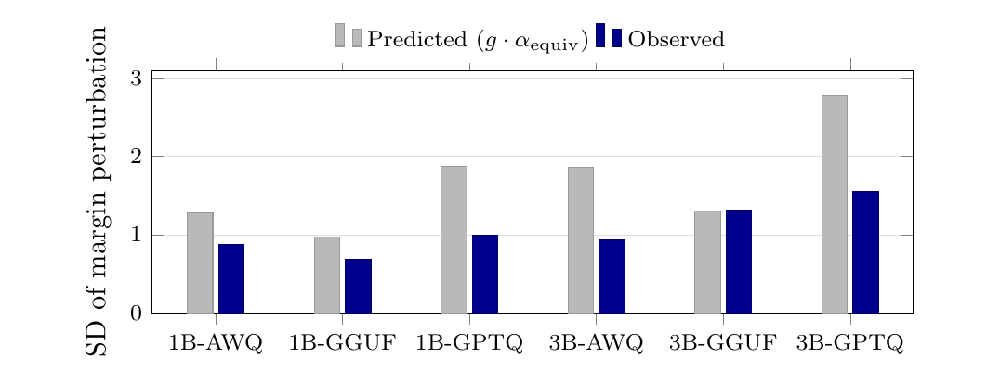

```text
██████╗ ████████╗ ██████╗     ███████╗██╗     ██╗██████╗ ███████╗
██╔══██╗╚══██╔══╝██╔═══██╗    ██╔════╝██║     ██║██╔══██╗██╔════╝
██████╔╝   ██║   ██║   ██║    █████╗  ██║     ██║██████╔╝███████╗
██╔═══╝    ██║   ██║▄▄ ██║    ██╔══╝  ██║     ██║██╔═══╝ ╚════██║
██║        ██║   ╚██████╔╝    ██║     ███████╗██║██║     ███████║
╚═╝        ╚═╝    ╚══▀▀═╝     ╚═╝     ╚══════╝╚═╝╚═╝     ╚══════╝
```

<h2 align="center">A First-Order Theory of Decision Flips Under Post-Training Quantization:<br>What It Predicts, and Where It Breaks</h2>

<p align="center">
  <b>Muhammed Razan</b> · <b>G Shivam</b><br>
  B.M.S. College of Engineering<br>
  <i>NeurIPS 2026 Workshop: AXIOM Foundations of Efficient Deep Learning · Paris</i>
</p>

<p align="center">
  <a href="https://openreview.net/forum?id=S5ack3Pfuc"></a>
  <a href="https://neurips.cc/virtual/2026/loc/paris/156960"></a>
  <a href="https://huggingface.co/datasets/razancodes/ptq-refusal-flips"></a>
  <a href="LICENSE"></a>
  
</p>

---

**TL;DR.** Treat 4-bit quantization as a weight perturbation and first-order
theory gets the *size* of the effect right, but not *which* refusals flip. The
pre-quantization margin, one forward pass on the fp16 model, predicts the flips
far better than the theory's own quantity.

- **What it predicts:** the spread of the refusal-margin shift, within 2x on
  all six Falcon3 model-by-format cells, calibrated against measured AWQ, GPTQ
  and GGUF error.
- **Where it breaks:** the zero-crossing flip criterion under-predicts flip rates
  by 3.5 to 337x. Refusals give way while the measured margin is still positive,
  which traces the gap to a decision boundary that sits away from zero.
- **What works instead:** on Falcon3, ranking prompts by the fp16 margin `m0`
  (AUC 0.948) beats ranking by the measured margin shift (AUC 0.715).

<p align="center">
  
  <br><sub>Predicted (g · α<sub>equiv</sub>) versus observed spread of the margin shift, Falcon3-1B/3B. No cell misses by more than 2x.</sub>
</p>

## Results

| | |
|---|---|
| Variance model, observed / predicted spread | within 2x on 6 of 6 cells, median 0.62 |
| Zero-crossing criterion, observed / predicted flip rate | 3.5x to 337x |
| Falcon3 refusal breaks with a positive post-quantization margin | 57 of 59 |
| Flip prediction, Falcon3 (1,788 pairs): `m0` vs `Δm` | AUC 0.948 vs 0.715 |
| `m0` within the fp16-refused stratum: Falcon3 / Llama-3.2 / Qwen2.5 | AUC 0.952 / 0.949 / 0.902 |

Six instruction-tuned models (Falcon3, Llama-3.2, Qwen2.5 at two sizes each),
three 4-bit formats, 300 jailbreak prompts, greedy decoding stated explicitly.

## Quickstart

Every number in the paper regenerates from the committed raw measurements on a
CPU in about a minute.

```bash
git clone https://github.com/razancodes/ptq-decision-flips.git
cd ptq-decision-flips
pip install -r requirements.txt

python reproduce.py       # rebuild every derived result from the raw data
python verify_paper.py    # check each number the paper prints
```

```text
...
108 of 108 numbers verified, 0 failed, 0 unverifiable.
```

## Dataset

The paired decisions are on the Hugging Face Hub: 5,386 fp16-versus-quantized
pairs with both replies, judge labels, flip direction, `m0`, `Δm`, and human
labels on all 267 flips. Access is gated: accept the terms on the dataset page,
then log in with `hf auth login`.

```python
from datasets import load_dataset

pairs = load_dataset("razancodes/ptq-refusal-flips", split="train")
breaks = pairs.filter(lambda r: r["break"] == 1)
```

The data contains harmful-instruction prompts and model replies to them. It is
released for AI-safety research.

## Repository

```text
reproduce.py · verify_paper.py   rebuild the analysis · check the paper's numbers
checkpoints.json                 the exact Hugging Face commit of every checkpoint
experiments/                     GPU drivers: generation, margins, tensor error, LLM judge
experiments/kernels/             each Kaggle kernel exactly as it ran
experiments/analysis/            CPU analysis, run in order by reproduce.py
results/                         raw measurements and every derived artifact
hf_dataset/                      builder and card for the Hugging Face dataset
docs/REPRODUCIBILITY.md          result-to-script map, GPU re-runs, caveats
```

To re-run the GPU measurements or trace a number to its script, see
[docs/REPRODUCIBILITY.md](docs/REPRODUCIBILITY.md).

## Citation

```bibtex
@inproceedings{razan2026firstorder,
  title     = {A First-Order Theory of Decision Flips Under Post-Training Quantization:
               What It Predicts, and Where It Breaks},
  author    = {Razan, Muhammed and Shivam, G},
  booktitle = {NeurIPS 2026 Workshop: AXIOM Foundations of Efficient Deep Learning},
  year      = {2026},
  url       = {https://openreview.net/forum?id=S5ack3Pfuc}
}
```

## License

Code is MIT. Our labels and measurements are CC BY 4.0; model replies keep their
models' licenses ([LICENSE-DATA](LICENSE-DATA)).
